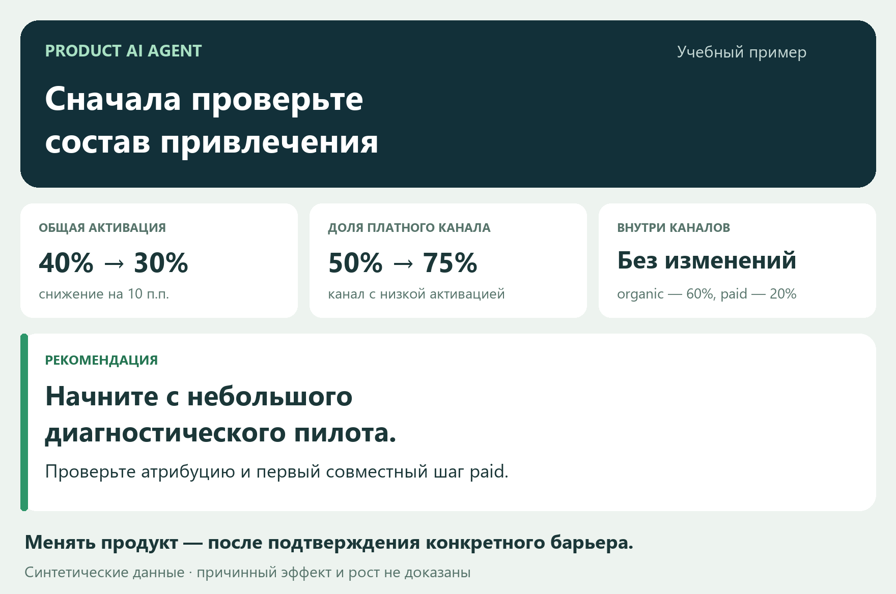

# Product AI Agent

Помощник руководителя продукта: изучает материалы, проверяет основания и превращает вопрос в понятную рекомендацию и план действий. Для полной стратегической задачи готовит согласованные продуктовую и коммуникационную стратегии.

## Начать за три шага

1. Скачайте эту ветку или готовый архив и распакуйте папку.
2. В Windows дважды нажмите **START.cmd**. Установка и проверка выполнятся автоматически.
3. Выберите **Демо**, **Моя задача** или **Продолжить**. Отправьте подготовленное сообщение в Codex.

Дальше достаточно общаться обычными фразами. Агент сам вызывает инструменты и сохраняет работу. На существенном выборе он спросит вас. Установка инструментов нужна один раз.

**До запуска:** нужен Python 3.11+ (проверен 3.13.0), готовая среда с LLM и доступом к файлам/терминалу. Первый запуск загружает зависимости с PyPI. Доступ/подписка к модели предоставляются средой и оплачиваются отдельно. Наши инструменты отдельного LLM API-ключа не требуют.

[Посмотреть готовый результат](demo/decision.html) · [Короткая инструкция](START_HERE.md) · [Комплект для сдачи](submission/README.md)

[](demo/decision.md)

## Что вы получите

- Короткую карточку: **что делать, почему и какой следующий шаг**.
- Проверяемые факты и расчёты, ограничения и открытые вопросы.
- Разные действия с сильными возражениями; объём работы соответствует задаче.
- Проверку рекомендации перед выдачей: основания, возражения, продуктовые обещания и выполнимость следующего шага.
- Для стратегического выбора — согласованный с вами план и способ проверки.
- Сохранённое решение, условия пересмотра и продолжение в новом чате.

«Начни исследование», «Остановись и сохрани», «Продолжи», «Вот новые данные — проверь решение» — основные пользовательские действия. JSON, ревизии и внутренние ID ведёт агент.

## Процесс под вашу задачу

| Запрос | Что делает агент |
|---|---|
| Почему изменилась метрика или возникла проблема? | Диагностика, альтернативные объяснения и следующая проверка |
| Кому предлагать продукт? | Сравнение аудиторий и предложений, затем план по вашему выбору |
| Как объяснить ценность? | Варианты сообщения и каналов с проверкой продуктовых обещаний |
| Какое направление выбрать? | Полное исследование, варианты и обе стратегии |

Агент сам выбирает и объясняет подход. Использует необходимые материалы; для узкой задачи не нужно искусственно собирать документ, таблицу и сайт. Числовые выводы требуют воспроизводимого расчёта, качественные — проверяемых оснований. Завершённая диагностика не означает разрешение менять продукт или тратить бюджет.

Перед рекомендацией сохраняется содержательная самопроверка. Инструменты замечают отсутствующие или отозванные ссылки, незакрытые замечания и устаревшее ревью после изменений. Истинность источников и причинность всё равно требуют содержательной оценки — автоматического доказательства здесь нет.

## Своя задача

Положите разрешённые документы и таблицы в **inbox** и в чате опишите решение: например, «Помоги выбрать аудиторию платного предложения; используй материалы из inbox». Укажите разрешённые публичные ссылки. Входы копируются в отдельный проект, исходные файлы не меняются.

Поддержаны Markdown/TXT, DOCX, CSV, XLSX и статические открытые HTML-страницы. Формулы Excel не вычисляются; страницы с логином/обязательным JavaScript, PDF/OCR, аудио и видео не входят в заявленный импорт. Неподдерживаемый материал даёт явную диагностику.

## Где работает

Это переносимая папка агента. LLM и цикл действий предоставляет Codex, Cursor или другая готовая среда. Отдельный сервер, веб-приложение и собственный агентный движок не устанавливаются. HTML - локальные страницы запуска и отчёта, работающие без сервера.

Codex подключает AGENTS.md. Для Cursor добавлен адаптер .cursor/rules. Фактически проверен Windows/Codex/Python 3.13.0; запуск в Cursor и других ОС ещё не заявляется проверенным. В любой среде можно явно попросить прочитать instructions/product.md.

## Демонстрация и проверяемость

Основной учебный проект прошёл документы, CSV, настоящую разрешённую страницу, расчёт, четыре альтернативы, **реальный выбор пользователя** и продолжение в отдельном чате. [Сохранённый пример](demo/README.md). Учебные продуктовые сведения не доказывают реальный спрос.

Второй кейс проверяет выбор аудитории онлайн-записи с другими полями и метриками: [examples/booking](examples/booking/README.md). Он корректно остановлен на выборе пользователя. Изменение данных отдельно проверяет поиск затронутых утверждений и решения.

Короткий качественный сценарий без таблицы: [диагностика экспорта](examples/export-diagnosis/README.md). [Сравнение с обычным чатом](evals/runs/2026-11-07-diagnosis/README.md) показывает фактические результаты и цену сохранённого процесса; превосходство не предполагается заранее.

## Для разработки

Код находится в src/product_ai_agent, проверки - tests. [Технический маршрут](docs/DEVELOPMENT.md), [контракты](docs/CONTRACTS.md), [фактический статус](docs/STATUS.md). Подробности реализации не нужны для пользовательского старта.

```powershell
# Для клонирования именно готовой ветки:
git clone --branch feat/v0-prototype --single-branch https://github.com/ST34LTH-KAPI-0SHON/product_ai_agent.git
```

Версия 0.3.0. Команда: тимлид (аналитика/ML) и Темур (backend); первый продукт подготовлен тимлидом с помощью Codex до подключения Темура. Условия конкурса и границы сдачи - в submission/README.md.
